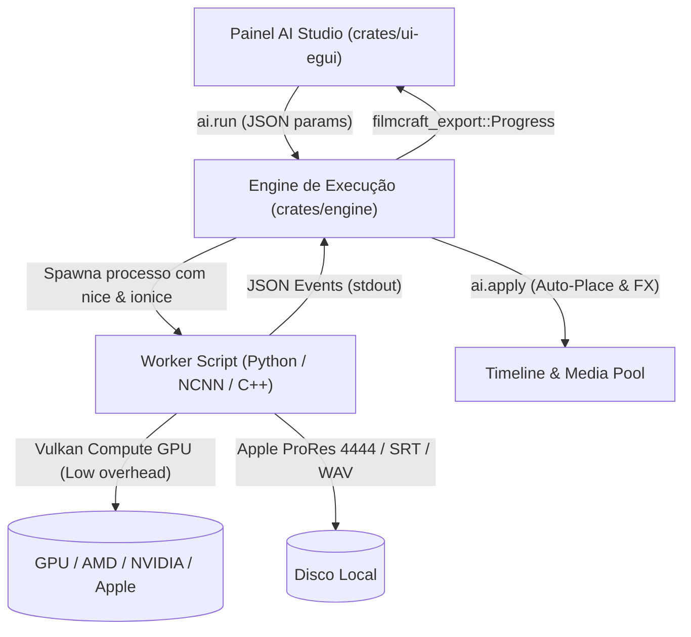

# Guia de Extensibilidade: FilmCraft AI Studio

O **AI Studio** do FilmCraft foi arquitetado do zero para ser um ecossistema modular e desacoplado. Qualquer inteligência artificial — seja para vídeo, áudio, cor ou geração de metadados — pode ser integrada diretamente ao editor sem congelar a interface (UI) e sem exigir comandos manuais no terminal.

Este guia detalha o funcionamento interno da arquitetura e demonstra, passo a passo, como registrar e conectar novos modelos neurais (como Whisper para legendas automáticas ou Demucs para isolamento de voz) em menos de 100 linhas de código.

---

## 1. Visão Geral da Arquitetura

O ecossistema de IA do FilmCraft é composto por 4 camadas essenciais:



1. **Painel Interativo (`crates/ui-egui/src/panels/ai_hub.rs`)**:
   - Renderiza a interface do editor com detecção do clipe selecionado na timeline.
   - Fornece controles em tempo real (presets, sliders, seletores de modelo e telemetria de hardware).
   - Acompanha o progresso assíncrono via `app.session.jobs` sem travar a thread de renderização de 60 FPS da UI.

2. **Engine de Comandos & Jobs (`crates/engine/src/ai.rs`)**:
   - Expõe os comandos fundamentais: `ai.tools`, `ai.run`, `ai.status`, `ai.cancel`, `ai.apply`.
   - Executa os workers em background threads, consumindo os eventos de progresso e repassando para o sistema global de exportação e jobs do FilmCraft (`filmcraft_export::Progress`).

3. **Workers Desacoplados (`crates/engine/scripts/*.py` ou binários nativos)**:
   - Rodam isolados com prioridade reduzida no sistema operacional (`nice -n 19 ionice -c 3`), garantindo que o computador do editor não trave nem engasgue outros apps (ex: players de vídeo, navegadores).
   - Utilizam aceleração Vulkan / GPU de alto desempenho e transmitem eventos linha a linha (`newline-delimited JSON`) pelo `stdout`.

4. **Automação de Linha do Tempo (`ai.apply`)**:
   - Ao término do job, registra os arquivos de mídia gerados na Pool de Mídia (`file.import`).
   - Insere os novos clipes na trilha apropriada (`V2` para overlays de vídeo, `A2/A3` para trilhas de áudio, ou trilha de legendas).
   - Copia automaticamente keyframes e propriedades de transformação (posição, escala e âncora) do clipe original.

---

## 2. Protocolo de Comunicação IPC (JSON Streaming)

O worker deve imprimir exclusivamente mensagens JSON estruturadas no `stdout`, finalizadas com `\n`. Avisos de inicialização ou depuração de bibliotecas (como NCNN ou PyTorch) devem ser silenciados ou direcionados para `stderr`.

### Eventos Obrigatórios

#### 1. Início de Processamento (`started`)
Emitido quando os pesos do modelo foram carregados e o processamento dos dados iniciou.
```json
{
  "type": "started",
  "total": 300,
  "status": "Iniciando processamento com aceleração Vulkan GPU"
}
```

#### 2. Progresso por Amostra / Frame (`progress`)
Emitido periodicamente (ou a cada frame) para atualizar a barra de progresso, FPS e estimativa de tempo (ETA).
```json
{
  "type": "progress",
  "current": 42,
  "total": 300,
  "fps": 24.5,
  "status": "Processando frame 42 de 300 (24.5 FPS)"
}
```

#### 3. Conclusão com Sucesso (`completed`)
Emitido ao finalizar a geração do arquivo final em disco.
```json
{
  "type": "completed",
  "path": "/home/user/Videos/scrp/webcam_rvm_alpha.mov",
  "frames": 300,
  "seconds": 12.2,
  "fps": 24.59
}
```

#### 4. Tratamento de Falhas (`error`)
Emitido caso ocorra falta de VRAM, arquivo corrompido ou exceção.
```json
{
  "type": "error",
  "message": "Memória de vídeo insuficiente para resolução 4K"
}
```

---

## 3. Passo a Passo: Registrando uma Nova Ferramenta

### Etapa 1: Adicionar ao Catálogo em `crates/engine/src/ai.rs`

Edite a função `available_tools()` para declarar o novo módulo:

```rust
AiToolInfo {
    id: "caption.whisper".to_string(),
    name: "Auto-Legendas (Whisper Local)".to_string(),
    category: "Audio".to_string(),
    description: "Transcrição neural palavra por palavra com sincronia na timeline.".to_string(),
    accelerated: true,
    inputs: vec!["clip".to_string(), "sequence".to_string()],
}
```

### Etapa 2: Mapear no Dispatcher de Execução (`run_tool`)

Dentro de `crates/engine/src/ai.rs`, conecte o ID da ferramenta ao seu respectivo script worker:

```rust
match tool.as_str() {
    "matting.rvm" => {
        // Dispara rvm_vulkan_worker.py
    }
    "caption.whisper" => {
        let script = base_dir.join("crates/engine/scripts/whisper_worker.py");
        // Executa script passando o arquivo de áudio ou vídeo
    }
    _ => return Err(bad("Ferramenta de IA desconhecida")),
}
```

---

## 4. Exemplo Prático: Módulo Whisper em < 60 Linhas

Abaixo está um worker completo em Python para transcrição local usando Faster-Whisper ou Whisper.cpp com aceleração de hardware:

```python
#!/usr/bin/env python3
import sys, json, time, argparse
from faster_whisper import WhisperModel

def emit(data):
    sys.stdout.write(json.dumps(data) + "\n")
    sys.stdout.flush()

def main():
    parser = argparse.ArgumentParser()
    parser.add_argument("--input", required=True)
    parser.add_argument("--output", required=True)
    parser.add_argument("--model", default="small")
    args = parser.parse_args()

    t0 = time.time()
    # Inicializa o modelo no dispositivo disponível (GPU / Vulkan / CPU)
    model = WhisperModel(args.model, device="auto", compute_type="float16")
    
    emit({"type": "started", "total": 100, "status": "Transcrevendo áudio..."})
    
    segments, info = model.transcribe(args.input, beam_size=5, word_timestamps=True)
    results = []
    
    for i, seg in enumerate(segments):
        results.append({
            "start": seg.start,
            "end": seg.end,
            "text": seg.text
        })
        prog = min(int((seg.end / info.duration) * 100), 99)
        emit({
            "type": "progress",
            "current": prog,
            "total": 100,
            "status": f"Transcrevendo: {seg.text[:30]}..."
        })

    with open(args.output, "w", encoding="utf-8") as f:
        json.dump(results, f, ensure_ascii=False, indent=2)

    elapsed = max(time.time() - t0, 0.001)
    emit({
        "type": "completed",
        "path": args.output,
        "frames": len(results),
        "seconds": round(elapsed, 2),
        "fps": round(len(results) / elapsed, 2)
    })

if __name__ == "__main__":
    main()
```

---

## 5. Exemplo Prático: Isolamento Vocal (Demucs) em < 50 Linhas

Worker para separação de fontes sonoras (voz do streamer limpa de música de fundo):

```python
#!/usr/bin/env python3
import sys, json, time, subprocess, argparse, os

def emit(d):
    sys.stdout.write(json.dumps(d) + "\n"); sys.stdout.flush()

def main():
    parser = argparse.ArgumentParser()
    parser.add_argument("--input", required=True)
    parser.add_argument("--outdir", required=True)
    args = parser.parse_args()

    t0 = time.time()
    emit({"type": "started", "total": 100, "status": "Isolando voz com Demucs..."})

    cmd = ["demucs", "--two-stems=vocals", "-o", args.outdir, args.input]
    proc = subprocess.Popen(cmd, stdout=subprocess.PIPE, stderr=subprocess.DEVNULL, text=True)
    proc.wait()

    vocals_path = os.path.join(args.outdir, "htdemucs", os.path.splitext(os.path.basename(args.input))[0], "vocals.wav")
    elapsed = max(time.time() - t0, 0.001)

    emit({
        "type": "completed",
        "path": vocals_path,
        "frames": 1,
        "seconds": round(elapsed, 2),
        "fps": 1.0
    })

if __name__ == "__main__":
    main()
```

---

## 6. Boas Práticas & Diretrizes AAA

1. **Proteção do Desktop do Usuário (`nice` e `ionice`)**:
   - Todo processo filho invocado pelo FilmCraft deve usar prioridade baixa (`nice -n 19 ionice -c 3`). Isso assegura que outras tarefas do usuário (streaming, jogos ou reprodução multimídia) mantenham taxa de quadros estável sem travamentos.
2. **Canal Alfa de Alta Fidelidade**:
   - Para overlays de vídeo transparente, prefira sempre codecs profissionais como **Apple ProRes 4444** (`yuva444p12le`) com canal alfa nativo em vez de sequências descompactadas de PNGs soltos.
3. **Gerenciamento de Stderr**:
   - Defina `cmd.stderr(Stdio::null())` ou trate a leitura em thread separada para evitar preenchimento de buffer do pipe (`SIGPIPE` / deadlock de 64 KB no Linux).
4. **Respeito aos Efeitos da Timeline**:
   - No comando `ai.apply`, sempre transfira a lista de efeitos (`effects`) do clipe fonte para o novo clipe gerado, mantendo escala de webcam, posição nos cantos da tela e máscaras aplicadas pelo usuário.
